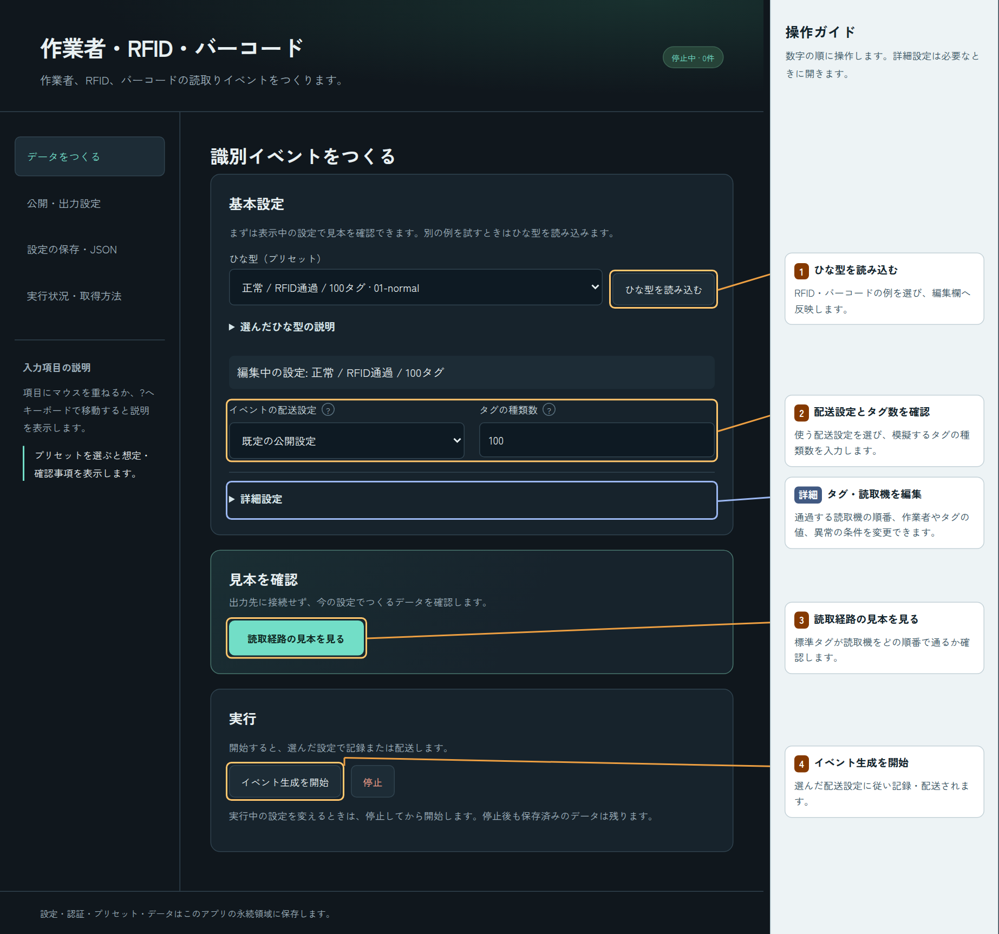

# 作業者・RFID・バーコード模擬

[プリセット一覧](presets/README.md) · [Dokploy配備手順](docs/dokploy-deploy.md) · [コード読解ガイド](docs/code-reading-guide.md)

材料・仕掛品・作業者の通過、所在、投入、検品を読取イベントとして再現します。tag_id、96bit表記のEPC、reader_id、operator_id、lot_id、direction、チェックディジット付きEAN13、event_idを生成。作業者名は架空の識別子です。

- 読取機の配列を通過経路として扱い、各タグが順番に移動します。タグ数、読取機、作業者、件数、周期、任意項目と生成条件を編集可能。
- captureで永続記録、MQTT（QoS1、ユーザー認証、任意TLS）またはHTTP(S)へのJSON POSTで配送。HTTPは任意Bearer認証、リダイレクトしません。TLSはCAとホスト名を検証。
- 二重読取は同じevent_idのまま再出力。読み飛ばし、予定外の読取機、未登録作業者、固着、バーストを再現。
- `/source/events?limit=100`で状態を確認。`/source/labels/0.png?format=code128`、`format=ean13`、`format=qr`で実際に読み取れるPNGを取得。

ラベル番号は0〜tags-1。Code128/QRはTAG-000000形式、EAN13は490000000000を基準にチェックディジットを計算します。任意のtag_id項目を上書きする場合、標準ラベルAPIのタグとは別になるため、受信試験のキーを合わせてください。

再開位置とoutboxを永続化し、再起動後に同じ位置から継続します。MQTTはブローカーPUBACK、HTTPは2xxまでが受付判定で、下流保存の完了保証ではありません。通信とDB更新が分かれるため重複し得ます。pendingは配送先のfingerprint単位で保持し、別の送信先へ自動転送しません。

RFIDのRF無線、LLRP、実スキャナーのUSB/HID、GS1の業務ルール全般は実装していません。模擬するのは取り込み側が受け取るイベントとラベルです。

## 操作ガイド

[](docs/images/operation-guide.png)

1. RFIDやバーコードのひな型を読み込みます。
2. イベントの配送設定と、模擬するタグの種類数を選びます。
3. 「読取経路の見本を見る」で、タグがどの読取機を通るか確認します。
4. 「イベント生成を開始」で、選んだ配送設定に従って記録・配送します。

「詳細設定」を開くと、データ項目・型・生成規則・異常データなどを変更できます。接続方式や認証は「公開・出力設定」で管理し、設定を再利用する場合は「設定の保存・JSON」を使います。

## 設定の保存と運用

1. 「公開・出力設定」で方式・認証・接続先を保存。
2. 「データをつくる」でプリセットを読み込み、任意項目・型・生成器・異常ルールと個別設定を編集。
3. 「読取経路の見本を見る」で、同じ標準タグ位置について先頭8か所までの通過例を確認します。設定上の読取機と、タグIDの上書きや異常注入を適用した後の生成値を並べて表示します。
4. 停止してから開始すると新しい設定を適用。実行中は設定とプロファイルの版を固定します。
5. 「設定を保存・JSONで編集」からJSONを編集・検証・取り込み・書き出し・プリセット保存できます。

読み飛ばしや重複配送の有無は、実行後のイベントと配送状態で確認します。プレビューの経路例は標準の通過順を表示します。各入力欄の説明は「?」から表示できます。

24種類（通常12・異常12）のJSONを同梱。[一覧と詳細](presets/README.md)には想定・生成条件・確認事項を記載しています。再生成は`uv run python build_presets.py`。初回起動で未登録IDだけを追加し、保存済み設定は更新で上書きしません。

データ型はstring/integer/number/decimal/boolean/datetime/json。record_id、uuid、sequence、分布、重み付きchoice、テンプレート、参照、四則演算、時刻、NULL率、条件上書き、固着・ドリフト・欠落等を指定できます。共有パラメーターは`$名前`、テンプレートでは先行項目を参照。任意Pythonは実行しません。異常ルールの生成位置は各ドライバーが使う論理sequenceであり、必ずしもtickやAPIの読取順ではありません。

公開契約は[Spec JSON Schema](contracts/spec.schema.json)と[Profile JSON Schema](contracts/profile.schema.json)。Spec.version=1、内包するgeneratorは既存ツールと同じRunSpec.version=2です。SQL/ファイル/ストリーム専用の一部設定は内包モデルに残っていますが、このツールのフォームでは使う項目だけを表示します。

## 起動

Python 3.12、uv、Docker Composeを使用します。

```sh
uv sync --frozen
uv run python scripts/init_local.py --env-file .env
docker compose up -d --build
```

`.env`のAPP_PORTが画面のポート、BIND_IPは既定127.0.0.1。管理画面と操作APIはログイン不要です。直接起動する場合:

```sh
DATA_DIR="$PWD/data" AUTO_START=1 uv run uvicorn app:app --host 127.0.0.1 --port 8080 --workers 1
```

1アプリ1プロセス・1実行。AUTO_START=1は初回に既定プリセットを開始。その後は保存済みの停止・実行状態を復元します。Docker再作成後もnamed volumeへ設定・データを保持。初期設定は小規模で、速度は保証値ではありません。interval_ms、batch_size、タグ/設備/件数等を増やす場合も、CPU・メモリ・容量上限を合わせて設定してください。

## 認証・データと運用

管理画面と`/api/*`はログイン不要。 ローカルまたは信頼済みの検証環境向けです。既定のloopback公開を維持し、他端末から利用する場合は追加認証と到達元制限を別途設けてください。インターネットへの直接公開は避けてください。取得用`/source/*`の認証はプロファイルでnone/basic/bearer/api_key（X-API-Key）から別途選択します。APIへの変更操作は同一オリジンとapplication/jsonを要求。`/healthz`と`/metrics`も認証不要です。暗号化HTTPが必要な経路では既存のTLS終端を使用してください。

秘密情報はFernetで暗号化保存し、読み戻し・JSON書き出しから除外。同じ接続範囲なら未入力の資格情報を保持し、接続範囲が変われば引き継ぎません。clear_secretsで明示削除できます。証明書・秘密鍵・CAは画面からconnection-filesへ権限600で配置可能。

DATA_DIRにはsettings.sqlite3、source.key、connection-files、永続データを保存します。DBと暗号鍵は一緒にバックアップし、秘密情報として管理してください。暗号鍵だけを失うと復号できません。リポジトリへ認証情報・実行データは含めません。

ホストメモリ余力（既定6GiB）、ディスク余力2GiB、storage_limit_mbを監視し、閾値で生成を停止します。Composeは既定512MiB/1CPU、非root、read-only root、ログ上限、負荷ガード連携用のラベルを設定。`storage_limit_mb`はDATA_DIR配下の上限で、別マウントのログはローテーションで制限します。

`uv run pytest -q`と`uvx ruff check .`で検証。[検証記録](VALIDATION.json)に実接続と画面確認の範囲を記載しています。他ソースとの組み合わせとポート割り当ての参考例は[構成メモ](docs/architecture.md)を参照してください。実環境の接続情報は非公開の運用メモで管理してください。

## 外部監視用の管理ラベル

Composeの管理ラベルは既定で `factory.guard.managed=true` です。外部監視側との合意が必要な場合は、非公開の配備設定で `FACTORY_GUARD_LABEL_PREFIX` を指定できます。例えば説明用の値 `synthetic-guard` を指定すると、`synthetic-guard.guard.managed=true` になります。

既存の外部監視との互換性は未確認です。変更前に監視側が照合するラベル名と影響を確認してください。この設定は既存コンテナや監視設定を自動移行せず、デプロイも行いません。
