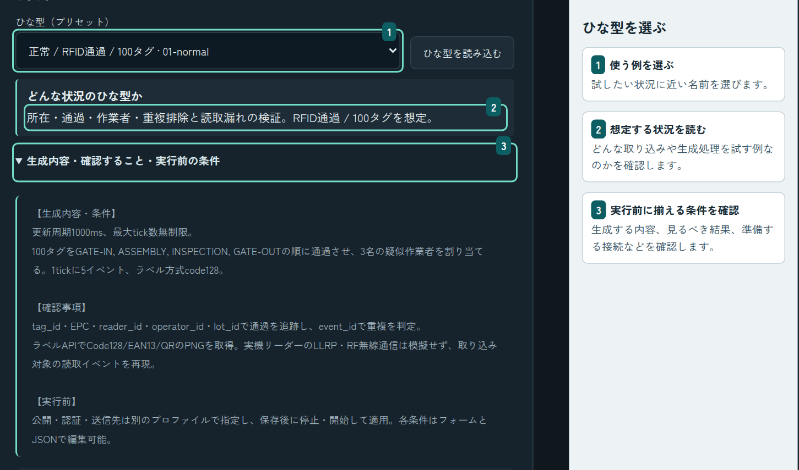
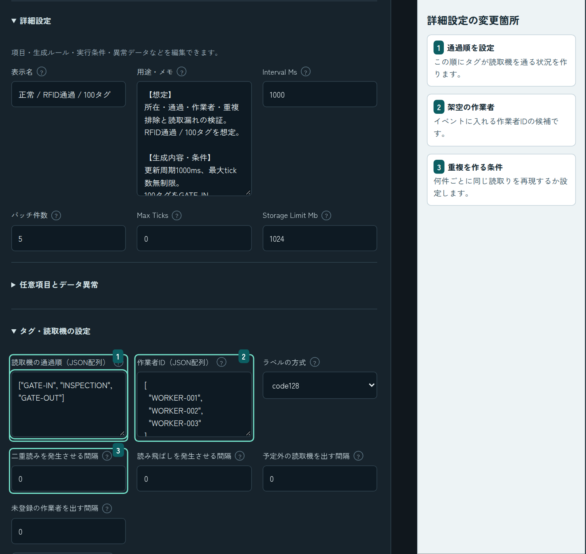
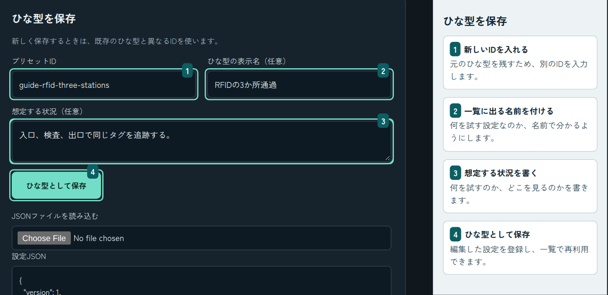

# 作業者・RFID・バーコードのひな型と詳細設定

ひな型（プリセット）は、生成するデータの項目・件数・書式や、再現したい異常をまとめた設定です。試したい状況に近いひな型を読み込み、見本を確認してから必要な設定を変えます。公開、書き込み、送信を始めるときは、画面の実行ボタンを使います。

## ひな型を選ぶ

**正常 / RFID通過 / 100タグ（01-normal）** を例にします。

タグ付きの品物が入口・組立・検査・出口を通り、取り込み側で同じ品物を追跡できるか調べる場面です。

「基本設定」でひな型を選び、「ひな型を読み込む」を押します。

「どんな状況のひな型か」で用途を確認し、「生成内容・確認すること・実行前の条件」で作るデータや準備を読みます。

「異常 / 二重読取（13-anomaly）」は同じイベントを複数回扱う例です。取り込み側が event_id で重複を判定できるか調べます。

全ひな型の用途は[プリセット一覧](../presets/README.md)を参照してください。

## 詳細設定を変更して見本を見る

「詳細設定 → タグ・読取機の設定 → 読取機の通過順（JSON配列）」に `["GATE-IN", "INSPECTION", "GATE-OUT"]` と入力します。角括弧、二重引用符、カンマも含めます。

| 設定 | 変えられること |
| --- | --- |
| 読取機の通過順（JSON配列） | 左から右に並べた順がタグの模擬経路になります。 |
| 作業者ID（JSON配列） | イベントに入る合成の作業者IDの候補です。 |
| 二重読み・読み飛ばしの間隔 | 何件ごとに重複や読取漏れを作るかを指定します。0は無効です。 |

**見本での確認**　「読取経路の見本を見る」で標準タグが GATE-IN、INSPECTION、GATE-OUT の順に通ることを確認します。読み飛ばしと重複配送は実行後のイベント・配送状態で確認します。

## 自分のひな型を作って保存する

1. 上の例で編集した設定を残すには、「設定を保存・JSONで編集」を押します。今の設定がJSON欄に入った保存画面が開きます。
2. 「プリセットID」に `guide-rfid-three-stations` のような新しいIDを入力します。半角英数字、ハイフン、下線が使えます。同じIDで保存すると、そのひな型を更新します。
3. 必要に応じて表示名と想定する状況を入力し、「ひな型として保存」を押します。画面で編集した設定は、JSON欄を書き直さず保存できます。
4. 生成画面の「基本設定」に戻り、新しく保存したIDを選んで「ひな型を読み込む」を押します。見本を出し、変更した条件が戻っていることを確認します。

たとえば検査を飛ばしたタグの扱いを確認するひな型なら、通過順に `GATE-IN`、`INSPECTION`、`GATE-OUT` を指定したうえで、「読み飛ばしを発生させる間隔」を設定します。プレビューで予定している通過順を確認し、どの読取機が欠けると異常と判断すべきかを想定する状況に書いて保存します。

共有するひな型には「RFIDの3か所通過」のような表示名と、「入口、検査、出口で同じタグを追跡する。」のような用途を書いておくと、次の人が選びやすくなります。接続先と認証は「公開・出力設定」で管理します。ひな型を別環境で使う場合は「JSONを書き出す」で持ち出し、利用先で接続設定を選び直します。

[操作ガイドに戻る](../README.md#操作ガイド)
