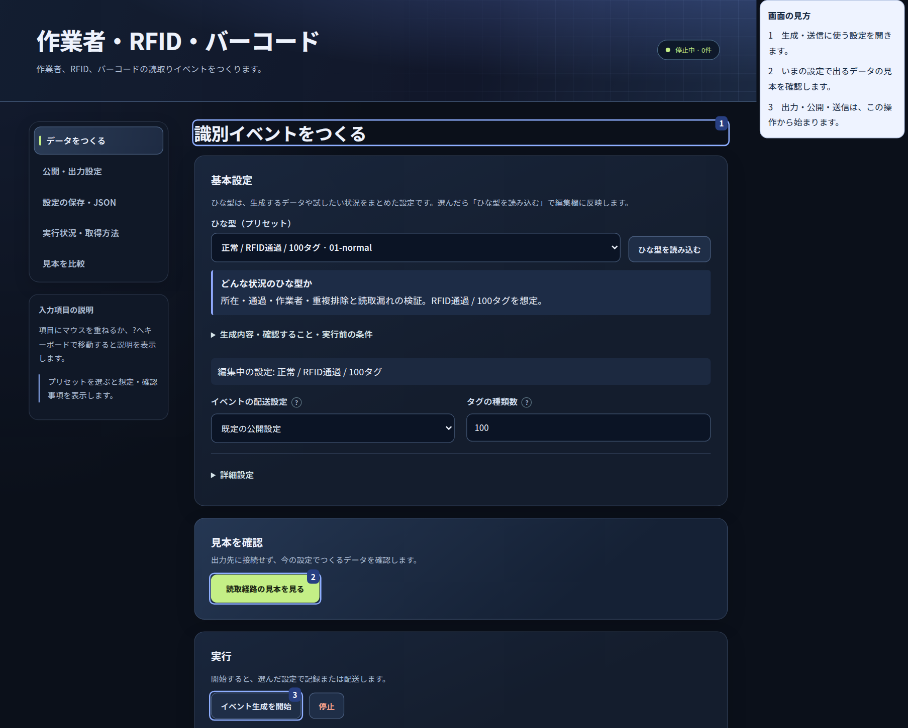

# RFID・バーコードシミュレーター 操作マニュアル

材料・仕掛品・作業者が入口から検査を通って出口へ進む状況を合成イベントで再現します。タグID・読取機ID・方向・作業者IDを確認でき、標準ラベルの画像も取得できます。

## 最初に試すこと

**タグが3か所を通過する順番とQRラベルを確認する**。タグ・読取機・時刻の記録が取得でき、先頭タグのQR画像を表示できます。

[Docker Compose導入手順](vm-compose.md)で準備し、VMで `http://127.0.0.1:3644/` を開きます。

タグはものや人を区別するためのID、読取機は入口や検査場などの通過地点です。captureを選ぶと外部のMQTTやHTTPサーバーなしで試せます。

1. 「正常 / RFID通過 / 100タグ」を読み込み、「公開・出力設定」でcaptureを選びます。
2. 「詳細設定」で読取機を `GATE-IN`、`INSPECTION`、`GATE-OUT` の順に揃え、「読取経路の見本を見る」で経路を読みます。
3. 「イベント生成を開始」を押し、同じアドレスの `/source/events?limit=20` を開きます。応答は新しい順なので、通過順を調べるときは `seq` を古い方から見ます。
4. 同じアドレスの `/source/labels/0.png?format=qr` を開きます。試験後は実行状況で停止します。

## よくある質問

### 同じタグの読取と二重読取はどう見分けますか？

`tag_id` はものを区別するIDです。二重読取は同一の `event_id` が再出力されるので、受信側で `event_id` も確認します。

### QRで使ったタグを変えたいです

ラベルAPIは指定番号の標準タグを画像にします。任意項目で上書きした `tag_id` と標準ラベルを区別します。

### 停止すると未配送のイベントはどうなりますか？

新規の生成と再試行は止まり、未配送のデータは保持されます。再開する前に同じ条件と送信先を確認します。

## 停止と再起動

発生器を停止すると新規イベントと配送再試行が止まります。履歴・未配送キューは保存されます。前回と同じ条件で続ける場合は、保存しておいたひな型を読み込み、同じ出力設定を選んでから「イベント生成を開始」を押します。同じ条件では保存位置から続きます。

## 想定した結果が出ないとき

HTTPの2xxやMQTTのPUBACKは受け付けを示します。下流に表示されない場合は、受信側の記録と照合してください。標準ラベルと独自上書きした `tag_id` も区別します。

## イベントとラベルを照合する

| 項目 | 役割 |
| --- | --- |
| tag_id、epc | タグを見分ける値。 |
| reader_id、direction | 読取機と通過方向。 |
| operator_id、event_type、lot_id | 作業者、読取イベントの種類、対象ロット。 |
| event_id | 本文内のイベントキー。二重読取の判定に使います。 |
| barcode | イベント本文の既定値はEAN-13形式の数字です。 |

生成項目で同名の業務項目を作る場合は、見本で上書きされる値を確認します。公開データの配送用IDと、payloadに含まれるイベントIDも区別します。ラベル方式（QR・Code128・EAN-13）は標準タグの画像表示に適用されます。

## 次に読む

- [ひな型を選ぶ・作る](preset-guide.md)
- [設定リファレンス](settings-reference.md)
- [JSONの書き方](template-guide.md)
- [APIの使い方](api-guide.md)
- [用語集](glossary.md)
